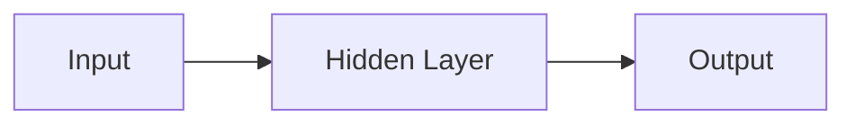
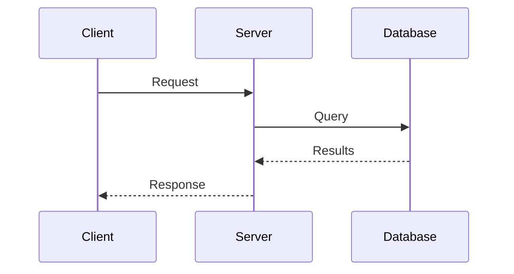

# Markdown Guide

This guide explains how to write markdown content that the `MarkdownRenderer` component will properly render, including the citation system, math equations, diagrams, and more.

## Table of Contents

- [Citations & References](#citations--references)
- [Math Equations](#math-equations)
- [Code Blocks](#code-blocks)
- [Mermaid Diagrams](#mermaid-diagrams)
- [Media (Images & Videos)](#media-images--videos)
- [Tables](#tables)
- [Other Formatting](#other-formatting)

---

## Citations & References

The markdown renderer supports an academic citation system with interactive tooltips.

### How It Works

1. **In-text citations**: Use `[[n]]` where `n` is the reference number
2. **References section**: Add a `## References` or `## Referencias` heading with numbered list items
3. **When clicked**: A tooltip appears showing the reference title and a link to the source

### Citation Format in Text

Use double brackets with the reference number:

```markdown
Neural networks have revolutionized machine learning [[1]], building on 
mathematical foundations established decades ago [[2]].

The attention mechanism [[1]] has become fundamental to modern NLP.
```

This renders as circular badges with numbers (①, ②) that show a tooltip when clicked.

### References Section Format

The references should be at the end of your document in a numbered list:

```markdown
## References

1. [Author, Name. "Title of the Paper". Conference/Journal, Year.](https://link-to-source.com)
2. [Another Author. "Another Title". Publisher, Year.](https://another-link.com)
3. [Third Author. "Third Paper Title". arXiv, Year.](https://arxiv.org/abs/...)
```

### Short Title Extraction

The tooltip displays a **short title** extracted automatically from your reference. The system looks for:

1. Text in quotes: `"Title Here"` or `"Title Here"`
2. Text in asterisks: `*Title Here*`
3. If neither found, uses the first part of the text (before first period or comma)

**Best Practice**: Always include the paper/book title in quotes for best results:

```markdown
## References

1. [Goodfellow, Ian, et al. "Deep Learning". MIT Press, 2016.](https://www.deeplearningbook.org/)
```

The tooltip will show: **Deep Learning** with a "View source →" link.

### Complete Example

```markdown
# Understanding Neural Networks

The field of deep learning [[1]] has grown exponentially since the 
introduction of efficient training algorithms. The backpropagation 
algorithm [[2]] remains fundamental to how we train neural networks today.

Modern architectures like Transformers [[3]] have revolutionized NLP 
by introducing the attention mechanism.

## Key Concepts

- Gradient descent is used for optimization [[2]]
- Attention allows models to focus on relevant parts of input [[3]]
- Deep networks can approximate complex functions [[1]]

---

## References

1. [Goodfellow, Ian, Yoshua Bengio, and Aaron Courville. "Deep Learning". MIT Press, 2016.](https://www.deeplearningbook.org/)
2. [Rumelhart, David E., et al. "Learning representations by back-propagating errors". Nature, 1986.](https://www.nature.com/articles/323533a0)
3. [Vaswani, Ashish, et al. "Attention Is All You Need". NeurIPS, 2017.](https://arxiv.org/abs/1706.03762)
```

---

## Math Equations

Uses KaTeX for rendering LaTeX math.

### Inline Math

Wrap equations in single dollar signs:

```markdown
The equation $E = mc^2$ shows mass-energy equivalence.

A vector $\mathbf{v} \in \mathbb{R}^n$ has $n$ components.
```

### Block Math

Wrap equations in double dollar signs:

```markdown
The gradient descent update rule:

$$
\theta_{t+1} = \theta_t - \eta \nabla_{\theta} \mathcal{L}(\theta_t)
$$

Matrix multiplication:

$$
\mathbf{C} = \mathbf{A} \mathbf{B} \quad \text{where} \quad c_{ij} = \sum_k a_{ik} b_{kj}
$$
```

### Common LaTeX Commands

| Symbol | LaTeX | Example |
|--------|-------|---------|
| Greek letters | `\alpha, \beta, \gamma` | α, β, γ |
| Subscript/Superscript | `x_i, x^2` | xᵢ, x² |
| Fractions | `\frac{a}{b}` | a/b |
| Square root | `\sqrt{x}` | √x |
| Summation | `\sum_{i=1}^n` | Σ |
| Integral | `\int_a^b` | ∫ |
| Matrices | `\begin{bmatrix}...\end{bmatrix}` | [matrix] |
| Bold (vectors) | `\mathbf{x}` | **x** |
| Calligraphic | `\mathcal{L}` | ℒ |

---

## Code Blocks

Code blocks have syntax highlighting (via Prism.js) and a copy button.

### Usage

````markdown
```python
import numpy as np

def neural_network(x, W, b):
    return np.maximum(0, np.dot(x, W) + b)  # ReLU activation
```
````

### Supported Languages

Python, JavaScript, TypeScript, Rust, Go, Java, C++, Bash, and many more.

---

## Mermaid Diagrams

Create interactive diagrams that can be clicked to expand.

### Flowcharts

````markdown

````

### Sequence Diagrams

````markdown

````

### Other Diagram Types

- `graph TD` - Top-down flowchart
- `graph LR` - Left-right flowchart
- `sequenceDiagram` - Sequence diagrams
- `classDiagram` - Class diagrams
- `stateDiagram` - State machines
- `gantt` - Gantt charts
- `pie` - Pie charts

---

## Media (Images & Videos)

### Images

```markdown

```

The description becomes a caption below the image.

### Videos

Videos are auto-detected by file extension (`.mp4`, `.webm`, `.mov`):

```markdown

```

---

## Tables

Use standard GitHub Flavored Markdown tables:

```markdown
| Algorithm | Complexity | Use Case |
|-----------|------------|----------|
| SGD | O(n) | Large datasets |
| Adam | O(n) | General purpose |
| L-BFGS | O(n²) | Small datasets |
```

---

## Other Formatting

### Headers

```markdown
# H1 - Main Title
## H2 - Section
### H3 - Subsection
#### H4 - Sub-subsection
```

### Text Styles

```markdown
**Bold text**
*Italic text*
`inline code`
```

### Blockquotes

```markdown
> "Mathematics is the language in which God has written the universe."
> — Galileo Galilei
```

### Lists

```markdown
- Unordered item 1
- Unordered item 2
  - Nested item

1. Ordered item 1
2. Ordered item 2
```

### Horizontal Rules

```markdown
---
```

### Links

```markdown
[Link text](https://example.com)
```

---

## Best Practices

1. **Citations**: Always put titles in quotes for proper short title extraction
2. **Math**: Use `\mathbf{}` for vectors, `\mathcal{}` for loss functions
3. **Code**: Always specify the language for proper highlighting
4. **References**: Keep the `## References` section at the very end of your document
5. **Diagrams**: Use Mermaid for technical diagrams - they're interactive!

## Troubleshooting

### Citations not linking?
- Ensure your `## References` section uses numbered list format: `1. [text](url)`
- Check that citation numbers match reference numbers

### Math not rendering?
- Make sure there are no spaces between `$` and the equation
- Use `$$` on separate lines for block equations

### Code not highlighted?
- Specify the language after the opening backticks: ` ```python `

