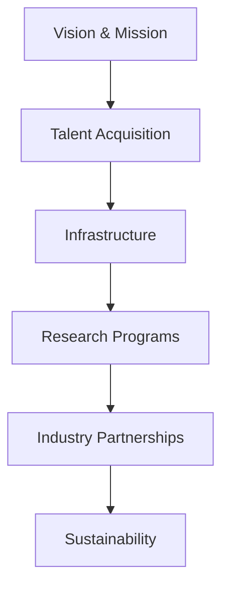

# Building an AI Lab in Latin America

The challenges and opportunities of creating AI research infrastructure in the region.

## Introduction

Establishing AI research capabilities in Latin America presents unique challenges and extraordinary opportunities. This post shares my experiences and lessons learned.

---

## The Current Landscape

Latin America's AI ecosystem is growing rapidly, but faces several challenges:

- Limited access to computational resources
- Brain drain to established tech hubs
- Funding constraints for basic research
- Language barriers in accessing cutting-edge literature

---

## Opportunities

Despite challenges, several factors make this an exciting time:

### 1. Untapped Talent Pool

Latin America produces excellent mathematicians and engineers. Many are eager to contribute to AI research but lack local opportunities.

### 2. Unique Problems to Solve

The region faces problems that demand innovative AI solutions:

| Domain | Challenge | AI Application |
|--------|-----------|----------------|
| Agriculture | Climate variability | Predictive modeling |
| Healthcare | Resource allocation | Optimization |
| Education | Access inequality | Personalized learning |

---

## Building the Foundation

Key elements for establishing a research lab:

---

## Lessons Learned

1. **Start with collaboration**: Partner with established institutions
2. **Focus on strengths**: Build on existing mathematical culture
3. **Create community**: Foster local AI meetups and events
4. **Think globally, act locally**: Address local problems with global methods

---

## Conclusion

Building AI research capacity in Latin America is challenging but essential. The region has the talent and motivation—what's needed is investment, infrastructure, and opportunity.

## References 

[1] 