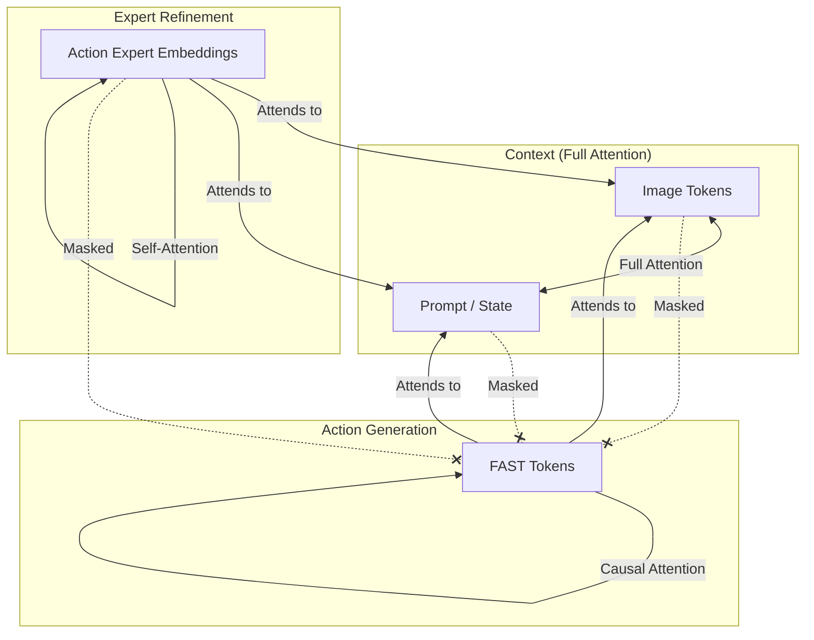

In this blog, we will primarily discuss the attention mechanism, but not from a unique perspective of Large Language Models. Instead, we will explore the general idea behind it. For this purpose, we will use another system that is quite related, which I like to exemplify because attention mechanisms vary and, furthermore, it is related to robotics. We will touch on the paper "Attention Is All You Need" [[1]]; however, we will not address the paper itself, but rather the attention mechanism that serves various types of information sources and how it works in general.

When we think about attention, we can ask: how can we explicitly compute the importance that one variable has over another? And beyond that, how can we also impose certain natural conditions of our problem so that this importance is logical and coherent with our problem? This is how I personally view attention, and below I will proceed to explain why.

# Representation

Before understanding what attention means, we must understand what representation is most commonly found in these types of systems and, in general, what attention means and what is the most common process for computing it.
For example, let's think about classification tasks: what are the most important parts for determining that a dog is a dog? Naturally, humans can identify this by assigning importance to the shape of the ears, the nose, the eyes, etc., and we can do this process naturally and even unconsciously.


So to perform this task, we can think that not the entire image matters, but only parts of it. Similarly, with tasks involving natural language processing (NLP), what parts of the sentence are most important for a task or to interpret a message?


And even more ambitiously, how can we compute attention, but this time in a **multimodal** way? That is, how can we compute attention between text, images, audio, etc., so that this attention spans all types of information sources. To achieve this, we will introduce the concept of **tokens**, surely familiar to all vibe coders. So basically, what we need is for these information sources to be representable in various subparts—for example, images where not all pixels are important—and to be able to capture attention between different types of information.

So the way to do this that has led us to the most powerful systems we have is basically to discretize these information sources into units of the same dimension called **tokens**. The idea behind this is to be able to divide the information source into small discrete subparts and also represent each piece as a vector, which theoretically is how it is represented in this **latent space**. This is done with all information sources so that they all lie in the same latent space, and given this, we can start doing mathematics in a more accessible way to compute attention relationships between all information sources, between all **tokens**.


Formally, given a set of $n$ different types of information $I_n$, we want to have a function that can convert this information source into $T_n \in \mathbf{R}^{t_n \times d_{model}}$ where $t_n$ represents the number of tokens that each information source has and $d_{model}$ represents the dimension of the latent space.
 
## Tokenizing Text

The process for doing this with text is basically to define a giant lookup table with up to 100,000 key-value entries that serves to subdivide words into smaller word pieces. It is common to also call these units tokens; however, we will use this term solely for the vector representation that each information source has within this latent space. This process, or the process of creating this lookup table, is given by Byte Pair Encoding. This is a compression algorithm that sought to optimize text representation using the smallest number of bytes possible. The most common citation for the use of this technique in NLP can be found here [[2]]. This type of technique for representing words was introduced in the GPT-2 paper [[3]].

Here is a reference image of what this looks like:


We can think that this representation is useful, since we have a **unique** representation for each token; however, even though it is unique, it lacks information. So we need to have a representation that is sufficiently unique, but that also has the capacity to store the information of said token and, in a certain way, give us the possibility to understand what its relationship is with other tokens. This is why we introduce the concept of *Embedding*.

An embedding is a vector whose function is to represent tokens in a specific dimension. In this case, the dimension will be denoted as $d_{\text{model}}$. The general operation is basically to have a kind of look-up-table such that we can map each token with its respective embedding. In this way, if our sentence has $N$ tokens, then after passing through the embedding process, we will have a matrix of dimension $N \times d_{\text{model}}$ where each row $i$ represents the corresponding token $i$.

The effectiveness of this approach is that we can now treat the parameters of each vector as model parameters, and intuitively, each of these vector representations should improve at each training step.

## Tokenizing Images

For the case of images, we will discuss the most well-known case, which consists of using ViT (Vision Transformer) [[4]], which basically consists of dividing images into patches and then projecting each of these patches into the latent dimension space.

Formally, this is represented as follows: given an image of size $\mathbf{x} \in (C \times H \times W)$, this is divided into $N$ patches $\mathbf{x_p} \in (N\times (P^2.C))$ where $(P,P)$ is the resolution of each patch and $N=HW/P^2$. This is achieved by creating the patches and then using a linear projector toward the dimension of the latent space (denoted by $D$ in the paper, $d_{model}$ in this blog).

$$
z_0 = [\mathbf{x}_{class},x^1_p\mathbf{E},...,x^N_p\mathbf{E}] \text{ where } \mathbf{E} \in \mathbb{R}^{P^2.C \times D}
$$


---

Previously, we showed which are the different techniques in which we can obtain these **tokens** within the different information sources such as language and images. This process can generally be repeated with other information sources such as audio [[6]], proprioceptive states of robots, or even using actions such as robot actions [[7]], etc. The idea is to be able to have these two important characteristics: having a representation that allows us to communicate with other information sources and having the property of being able to divide an information source into various parts.

# Attention Mechanism

Now we will discuss how we should compute attention. For this purpose, we will consider the case in which we perform *Self-Attention* and then we will explain the roles that the components have in order to compute other types of methods.

Given the vector representations, **tokens**, from different information sources represented in a matrix $X \in \mathbb{R}^{N \times d_\text{model}}$

$$
Q = X.W^Q \text{ where } W^Q \in \mathbb{R}^{d_{\text{model}}\times d_k}
$$

$$
K = X.W^K  \text{ where } W^K \in \mathbb{R}^{d_{\text{model}}\times d_k}
$$

$$
V = X.W^V  \text{ where } W^V \in \mathbb{R}^{d_{\text{model}}\times d_v}
$$

Let us consider the matrices $Q \in \mathbb{R}^{N\times d_k}, K \in \mathbb{R}^{N\times d_k}, V \in \mathbb{R}^{N\times d_v}$, where $Q, K, V$ are the matrices known as *Queries*, *Keys* and *Values* and $d_k,d_v \in \mathbb{N}$. In these matrices we are now storing different representations of the tokens. As we will see later, each of the matrices will have an important role when capturing "attention" and what this really means. Keep in mind that in each row $i$ we have the representation of each token $i$ in its respective representation. Then, in the paper they encode attention as:

$$
\text{Attention}(Q, K, V) = \text{softmax}\left(\frac{QK^T}{\sqrt{d_k}} \right)V
$$

Let us explain why this formula exists and the intuition behind it. Let's start with the basics.

## Matrix Multiplication

We can express matrix multiplication in the following mathematical terms. Let the matrices $Q \in \mathbb{R}^{N\times d_k}$ and $K \in \mathbb{R}^{N\times d_k}$, their product $S = QK^T$ (where $K^T$ is the transpose of $K$) will have dimension $S \in \mathbb{R}^{N \times N}$. If we take row $i$ and column $j$, each component of $S$ can be calculated as:

$$
S_{i,j} = \sum_{k=1}^{d_k} Q_{i,k} K^{T}_{k,j}
$$

In other words, we are performing an inner product between row $i$ of matrix $Q$ and row $j$ of $K$ (due to the transposition). Recall that we can consider each row of $Q$ and $K$ as the information in dimension $d_k$ of each token:

$$
\begin{bmatrix}
\text{token}_1 \\
\text{token}_2 \\
\vdots \\
\text{token}_N \\
\end{bmatrix}
$$

where each token $i$ is represented as a vector in $\mathbb{R}^{d_k}$:

$$
\text{token}_i \in \mathbb{R}^{d_k} \quad \text{(viewed as a row vector)}
$$

By performing the inner product between rows and columns, we store in component $S_{i,j}$ the cross-information between $\text{token}_i$ and $\text{token}_j$. In this way, we can represent in this matrix all the global information about the relationships between tokens and store these interactions in the resulting matrix.

## Normalization

However, it is necessary to apply a normalizing effect prior to applying the $softmax$ function. For this, we will analyze what role the dimension of the vectors plays when performing the inner product and its relationship with the derivative of $softmax$.
Let's start with a simple case. Let us take two vectors $q \in \mathbb{R}^{d_k}$ and $k \in \mathbb{R}^{d_k}$. Suppose both have $\mu=0$ and $\sigma^2=1$. Then, when performing the inner product, the resulting variable will have $\mu=0$ and $\sigma^2=d_k$. Therefore, as the dimension $d_k$ increases, the resulting value has a high probability of being a very negative or very positive number. 

Why is this a problem? Because it introduces instability, especially if we want to use the $softmax$ function, which is used in our attention formula. Let us analyze this phenomenon in detail.

## $Softmax$

The $softmax$ function is represented as:

$$
\text{softmax}(x)_i = \frac{e^{x_i}}{\sum_{j=1}^{n} e^{x_j}}
$$

Note that when applying $softmax$ to a vector, the result is a probability distribution, since it holds that:

$$
\sum_{i=1}^{n} \text{softmax}(x)_i = 1
$$

However, due to the form of this function, let us analyze what happens when the components of vector $x$ take very negative and very positive values.

Since the $softmax$ function does not have a scalar output, its derivative is represented by the *Jacobian*, since recall that:

$$
\frac{\partial f}{\partial v}(a) = Df(a) \cdot v
$$

where $Df(a)$ is the matrix composed of all partial derivatives of $f$.

In the case of the $softmax$ function, we have that:

$$
\frac{\partial \text{softmax}(x)_i}{\partial x_j} = \text{softmax}(x)_i \cdot (\delta_{i,j} - \text{softmax}(x)_j)
$$

where $\delta_{i,j}$ is the Kronecker delta.

Due to the form of this component of the Jacobian of the $softmax$ function, we can observe that in most cases its value is close to $0$. This can be demonstrated by considering different cases in which some components of vector $x$ are very positive and others very negative, and substituting them into the partial derivative of the function.

To illustrate this phenomenon in a practical way, we will perform a simulation in which we generate random vectors with $\mu=0$ and $\sigma^2=d_k$, and analyze how the norm of the Jacobian of the $softmax$ function decreases as the dimension $d_k$ increases. This implies that the gradients become very small, which makes training the model difficult. This effect, already analyzed in previous sections, is known as the *vanishing gradient* problem.


```python
import numpy as np
import matplotlib.pyplot as plt

def softmax(z):
    e_z = np.exp(z - np.max(z))
    return e_z / e_z.sum()

def softmax_jacobian(z):
    s = softmax(z).reshape(-1, 1)
    return np.diagflat(s) - np.dot(s, s.T)

def compute_jacobian_norm(z):
    J = softmax_jacobian(z)
    return np.linalg.norm(J, 'fro')

num_simulations = 1000
d_k_values = np.logspace(0, 4, 20)
norms = []

for d_k in d_k_values:
    current_norms = []
    for _ in range(num_simulations):
        z = np.random.normal(loc=0, scale=np.sqrt(d_k), size=50)
        current_norms.append(compute_jacobian_norm(z))
    norms.append(np.mean(current_norms))

plt.figure(figsize=(10, 6))
plt.scatter(d_k_values, norms, alpha=0.7, color='red')
plt.xscale('log')
plt.yscale('log')
plt.xlabel('$d_k$ (escala logarítmica)', fontsize=12)
plt.ylabel('Norma de Frobenius del Jacobiano (log)', fontsize=12)
plt.title('Decaimiento de la norma del Jacobiano de Softmax con $d_k$ grande', fontsize=14)
plt.grid(True, which="both", ls="--")
```


Now let's see what happens when we apply the normalizing effect. For this, it is sufficient to change the line of code:

```python
z = np.random.normal(loc=0, scale=np.sqrt(d_k), size=50)
z = z/np.sqrt(d_k)
```


Note that now, regardless of the size of dimension $d_k$, the norm of the Jacobian matrix remains stable and uniform without decay.

## Attention Mechanism

Now that we understand the multiplication of matrices $Q$ and $K$, the effect of normalization by its dimension $d_k$ and its implications when using $softmax$, we finally arrive at the question: why is it called an attention mechanism?

We define the resulting matrix from the $softmax$ operation as

$$
S = \text{softmax}\left(\frac{Q K^T}{\sqrt{d_k}}\right) \in \mathbb{R}^{N \times N}
$$

The next step to define attention ($Attention$) is to multiply by the matrix $V \in \mathbb{R}^{N \times d_v}$. However, the key to understanding this attention mechanism lies in expressing the rows of the attention matrix in the following form:

$$
Attention_i = \sum_{k=1}^{N} S_{i,k} V_k
$$

We can observe that row $i$ of $Attention$ is nothing more than a weighted sum of the rows of $V$, since, due to the $softmax$ function, we have that 

$$
\sum_{k=1}^{N} S_{i,k} = 1 \ \forall i = 1,2,...,N
$$

Intuitively, we are storing in each row of $Attention$ this weighted sum, where $S_{i,k}$ indicates what the relevance of each $token_k$ would be for $token_i$ using the "weights" determined by the matrix $S_{i,k}$.


## Multi-Head Attention

**Multi-Head Attention** is based on the idea of executing multiple attention operations in parallel, where each one works with lower-dimensional projections of the original space. Mathematically, each attention head is defined as:

$$
\text{head}_i = \text{Attention}(Q W^Q_i, K W^K_i, V W^V_i)
$$

where the projections are parameter matrices learned during training:

- $W^Q_i \in \mathbb{R}^{d_{\text{model}} \times d_k}$
- $W^K_i \in \mathbb{R}^{d_{\text{model}} \times d_k}$
- $W^V_i \in \mathbb{R}^{d_{\text{model}} \times d_v}$
- $W^O \in \mathbb{R}^{h d_v \times d_{\text{model}}}$

We use these matrices $Q,K,V$ as notation; however, these are equal to the initial matrix $M \in \mathbb{R}^{N \times d_{\text{model}}}$ that is obtained after passing through the embeddings and also through the positional encoding that we will see later. We see that in our formula we make the linear transformation explicit by placing the $W$ matrices inside.

These matrices project the inputs $Q$, $K$ and $V$ into lower-dimensional subspaces, allowing each head to process information independently. The relationship between dimensions to maintain the same complexity as using a single head is as follows:

$$
d_k = d_v = \frac{d_\text{model}}{h}
$$

Finally, the results of all heads are concatenated and projected back to the original space via a matrix $W^O$:

$$
\text{MultiHead}(Q, K, V) = \text{Concat}(\text{head}_1, \dots, \text{head}_h) W^O
$$

In this way, the model can learn and capture multiple relationships between words within the sequence from different representation subspaces. **Multi-Head Attention** allows the model to attend jointly to information from different subspaces at different positions, avoiding the information loss that would occur if only a single attention head were used.


## Positional Encoding

As discussed earlier, the self-attention mechanism processes tokens in parallel and is, by definition, **permutation invariant**. This means that for the network, the sequence $(A, B, C)$ is mathematically identical to the set $\{A, B, C\}$ without order. Unlike RNNs, which process the sequence step by step (and therefore possess an intrinsic temporal notion), the Transformer requires that we explicitly inject the notion of position.

This is achieved by adding **positional encodings** (PE) to the input embeddings. However, the choice of sinusoidal functions was not a random heuristic decision, but rather a construction designed to satisfy specific algebraic properties that facilitate learning the structure of language.

Let $d_{\text{model}}$ be the dimension of the embedding space. For a position $pos$ in the sequence and a dimension index $i$ (where $0 \le i < d_{\text{model}}/2$), the positional encoder is defined as a vector $\mathbf{p}_{pos} \in \mathbb{R}^{d_{\text{model}}}$ whose components are:

$$
\begin{align*}
PE_{(pos, 2i)} &= \sin(\omega_i \cdot pos) \\
PE_{(pos, 2i+1)} &= \cos(\omega_i \cdot pos)
\end{align*}
$$

Where the angular frequencies $\omega_i$ follow a geometric progression:

$$
\omega_i = \frac{1}{10000^{\frac{2i}{d_{\text{model}}}}}
$$

Below, we demonstrate why this formulation allows the model to manipulate spatial concepts through simple linear algebra.


### Translation Invariance (Relative Attention)

The most powerful property of this encoding is that it allows us to express position $pos + k$ as a linear function of position $pos$. This is crucial because it allows the model to learn to pay attention to "k positions back" independently of the absolute position in the text.

Let us consider the pair of dimensions $(2i, 2i+1)$ corresponding to frequency $\omega_i$. We want to find a relationship between the vector at $pos$ and the vector at $pos+k$. Using trigonometric identities for angle addition:

$$
\sin(\omega_i(pos + k)) = \sin(\omega_i pos)\cos(\omega_i k) + \cos(\omega_i pos)\sin(\omega_i k)
$$
$$
\cos(\omega_i(pos + k)) = \cos(\omega_i pos)\cos(\omega_i k) - \sin(\omega_i pos)\sin(\omega_i k)
$$

If we define the sub-vector at position $pos$ as $\mathbf{v}_{pos} = \begin{pmatrix} \sin(\omega_i pos) \\ \cos(\omega_i pos) \end{pmatrix}$, we can rewrite the above equations as a matrix multiplication:

$$
\mathbf{v}_{pos+k} = \begin{pmatrix} \cos(\omega_i k) & \sin(\omega_i k) \\ -\sin(\omega_i k) & \cos(\omega_i k) \end{pmatrix} \cdot \mathbf{v}_{pos}
$$

$$
\mathbf{v}_{pos+k} = \mathbf{M}_k \cdot \mathbf{v}_{pos}
$$

$\mathbf{M}_k$ is a **rotation matrix**. This demonstrates that there exists a constant linear transformation (a rotation) that allows the model to transition from any position to a relative neighboring position. The model only needs to learn the matrix $\mathbf{M}_k$ to understand the concept of "the next token" or "the previous token", regardless of whether it is at the beginning or end of the paragraph.


### Distance Preservation in the Dot Product

The attention mechanism calculates relevance between tokens through the dot product $\mathbf{q} \cdot \mathbf{k}$. It is vital that the positional encoding reflects physical proximity in this space.

If we calculate the dot product between the encodings of two positions $t$ and $s$:

$$
PE(t) \cdot PE(s) = \sum_{i=0}^{\frac{d}{2}-1} \left[ \sin(\omega_i t)\sin(\omega_i s) + \cos(\omega_i t)\cos(\omega_i s) \right]
$$

Applying the identity $\cos(A-B) = \cos A \cos B + \sin A \sin B$:

$$
PE(t) \cdot PE(s) = \sum_{i=0}^{\frac{d}{2}-1} \cos(\omega_i (t - s))
$$

The result is a symmetric function that depends solely on the distance $|t-s|$. This ensures that "positional similarity" decays (or varies periodically) consistently as tokens move apart, providing a clear proximity signal to the attention mechanism.


### Multi-Resolution Scale and Uniqueness

A common challenge in numerical encodings is to avoid collisions (where two distinct positions have the same representation) and to allow generalization to long sequences. This is where the geometric progression of frequencies $\omega_i$ plays a critical role.

Let us analyze the wavelength $\lambda_i$ for each dimension $i$:

$$
\lambda_i = \frac{2\pi}{\omega_i} = 2\pi \cdot 10000^{\frac{2i}{d_{\text{model}}}}
$$

This creates a spectrum of scales:

* **Low dimensions ($i \to 0$):** The wavelengths are short ($\lambda \approx 2\pi$). The functions oscillate rapidly. This allows for **high local precision**. Small changes in $pos$ result in large changes in the sine/cosine value, allowing distinction between $pos$ and $pos+1$.
* **High dimensions ($i \to d_{\text{model}}/2$):** The wavelengths are enormous ($\lambda \approx 10000 \cdot 2\pi$). The functions oscillate very slowly. This acts as a global anchor.

**Why is this mathematically necessary?**
Imagine that we only used high frequencies. Due to the periodicity of sine, we would have $PE(pos) \approx PE(pos + \lambda)$. This would introduce **aliasing**: the model would confuse distant positions with nearby ones. 

By introducing a continuous range of frequencies up to a base of $10000$, we are building a system analogous to **positional numerical notation** (such as the binary or decimal system), but in the continuous domain:

1.  In a binary number (e.g., `1011`), the least significant bit changes $(0, 1, 0, 1...)$ with maximum frequency.
2.  The most significant bit changes very slowly.
3.  For two numbers to be equal, **all** their bits must match.

Similarly, for $PE(pos_1) = PE(pos_2)$, all frequencies from the fastest to the slowest must match in phase. Given that $\lambda_{max}$ is extremely large ($10000 \cdot 2\pi$), this ensures that each position has a unique "fingerprint" within any reasonable context length, allowing the model to extrapolate and maintain coherence even if the sequence is very long.
## Masking

Another important component is Masking. This consists of a mechanism that allows us to choose how the attention of each token will be captured; that is, it will allow us to choose which information sources a specific token will attend to. This is done in the algorithm as a step prior to applying the $softmax$ function.

For example, for Large Language Models, we want that given a $token_i$, it only pays attention to previous tokens (or to itself), and not to future tokens, i.e., tokens $j$ with $j>i$. To achieve this, let us analyze our matrix prior to applying the $Softmax$ function, which is:

$$
S^* = \frac{QK^T}{\sqrt{d_k}}
$$

This matrix encodes the similarities (or scores) between all pairs of tokens. In expanded form, the matrix $S^*$ is:

$$
S^* =
\begin{bmatrix}
s_{1,1} & s_{1,2} & s_{1,3} & \cdots & s_{1,N} \\
s_{2,1} & s_{2,2} & s_{2,3} & \cdots & s_{2,N} \\
s_{3,1} & s_{3,2} & s_{3,3} & \cdots & s_{3,N} \\
\vdots  & \vdots  & \vdots  & \ddots & \vdots \\
s_{N,1} & s_{N,2} & s_{N,3} & \cdots & s_{N,N}
\end{bmatrix}
$$

However, note that component $S^*_{ij}$ represents the attention that $token_i$ pays to $token_j$. If $i<j$, this would imply that the current token is looking toward the future, which is not desired. As we mentioned, we want the model to only attend to itself and previous tokens.

An effective way to achieve this is by modifying $S^*$: we place $-\infty$ in all entries $S^*_{ij}$ where $i<j$. This guarantees that, when applying the $Softmax$ function, those positions will have zero probability, since:

$$
\text{Softmax}(-\infty) = 0
$$

Thus, our masked score matrix would be:

$$
\tilde{S}^* =
\begin{bmatrix}
s_{1,1} & -\infty & -\infty & \cdots & -\infty \\
s_{2,1} & s_{2,2} & -\infty & \cdots & -\infty \\
s_{3,1} & s_{3,2} & s_{3,3} & \cdots & -\infty \\
\vdots  & \vdots  & \vdots  & \ddots & \vdots \\
s_{N,1} & s_{N,2} & s_{N,3} & \cdots & s_{N,N}
\end{bmatrix}
$$

By applying $Softmax$ row by row, we obtain an attention matrix where probabilities toward the future are zero, and probabilities over the past and present sum to 1 in each row:

$$
\text{Softmax}(\tilde{S}^*) =
\begin{bmatrix}
p_{1,1} & 0 & 0 & \cdots & 0 \\
p_{2,1} & p_{2,2} & 0 & \cdots & 0 \\
p_{3,1} & p_{3,2} & p_{3,3} & \cdots & 0 \\
\vdots  & \vdots  & \vdots  & \ddots & \vdots \\
p_{N,1} & p_{N,2} & p_{N,3} & \cdots & p_{N,N}
\end{bmatrix}
$$

Finally, we satisfy that for each row $i$:

$$
\sum_{j=1}^i p_{i,j} = 1
$$

That is, the sum of probabilities that a token can attend to (only toward the past or to itself) is exactly 1.

However, this is a specific case for LLMs or models that have causal attention. However, we can find models with multiple information sources that will have other types of mechanisms, combining models that have causal masks, cross-attention, and self-attention on certain tokens.

An example of this can be found in Visual Language Action Models, specifically in the model called $\pi_{0.5}$ [[8]]. These models in general take as input different information sources, such as images, the language prompt, the proprioceptive state, and also Gaussian noise. Then, each information source will have its own tokens. So the way masking is done here is basically to have full-attention between image and language tokens. However, then we will have that the generated actions, at least in this FAST architecture [[7]], which treats robot actions as a next-token-prediction problem, will have among themselves causal attention and full attention toward the other information sources, and finally the action expert embedding will attend to the image and prompt information sources; however, it will not pay attention to FAST tokens; it is independent.

We can see a matrix of this in the following image:


Mathematically we can represent this as a block matrix $\tilde{S}^*_{\pi}$. Let us define the token blocks as $I$ (Image), $P$ (Prompt/State), $A$ (FAST Actions) and $E$ (Expert Embeddings):

$$
\tilde{S}^*_{\pi} =
\begin{bmatrix}
S_{II} & S_{IP} & -\infty & -\infty \\
S_{PI} & S_{PP} & -\infty & -\infty \\
S_{AI} & S_{AP} & \text{Causal}(S_{AA}) & -\infty \\
S_{EI} & S_{EP} & -\infty & S_{EE}
\end{bmatrix}
$$

Where the $-\infty$ blocks ensure that information does not flow where the model design prohibits it (for example, that images do not attend to future actions or that the expert ignores intermediate FAST tokens).

### Attention Flow Diagram




# The big picture

Here is a reference image summarizing everything we've discussed so far and providing a detailed view of the entire process of capturing attention between tokens.


It's worth noting that this image does not show how all the heads are combined. However, it serves as a good schematic to understand how each part works in detail to compute attention step by step.

# Conclusions

In this blog post, we've covered the main concepts behind the Transformer model, from attention to positional encodings and masking. These ideas are fundamental, as they are used in the vast majority of modern architectures, with each component evolving over time. In upcoming blogs, we will delve deeper and in greater mathematical detail into both advanced features found in attention models and the evolutions of these components, such as RoFormer [[9]], Gated Attention [[10]], and more.

## References

1. [Vaswani, Ashish, et al. "Attention Is All You Need". *NeurIPS*, 2017.](https://arxiv.org/abs/1706.03762)
2. [Rico Sennrich, Barry Haddow, Alexandra Birch, et al. "Neural Machine Translation of Rare Words with Subword Units"](https://arxiv.org/abs/1508.07909)
3.  [Radford, Alec, et al. "Language Models are Unsupervised Multitask Learners" (GPT-2). *OpenAI blog*, 2019.](https://www.google.com/search?q=https://d4mucfpksywv.cloudfront.net/better-language-models/language_models_are_unsupervised_multitask_learners.pdf)
4.  [Dosovitskiy, Alexey, et al. "An Image is Worth 16x16 Words: Transformers for Image Recognition at Scale". *ICLR*, 2021.](https://arxiv.org/abs/2010.11929)
5. [Bjorck, Johan, et al. "GR00T N1: An Open Foundation Model for Generalist Humanoid Robots". *NVIDIA*, 2024.](https://arxiv.org/abs/2503.14734)
6. [Défossez, Alexandre, Jade Copet, Gabriel Synnaeve, Yossi Adi. "High Fidelity Neural Audio Compression". 2022.](https://arxiv.org/abs/2210.13438)
7. [Pertsch, Karl, Kyle Stachowicz, Brian Ichter, Danny Driess, Suraj Nair, Quan Vuong, Oier Mees, Chelsea Finn, Sergey Levine. "FAST: Efficient Action Tokenization for Vision-Language-Action Models".](https://arxiv.org/abs/2406.02886)
8. [Physical Intelligence, Kevin Black, Noah Brown, James Darpinian, Karan Dhabalia, Danny Driess, Adnan Esmail, Michael Equi, Chelsea Finn, Niccolo Fusai, Manuel Y. Galliker, Dibya Ghosh, Lachy Groom, Karol Hausman, Brian Ichter, Szymon Jakubczak, Tim Jones, Liyiming Ke, Devin LeBlanc, Sergey Levine, Adrian Li-Bell, Mohith Mothukuri, Suraj Nair, Karl Pertsch, Allen Z. Ren, Lucy Xiaoyang Shi, Laura Smith, Jost Tobias Springenberg, Kyle Stachowicz, James Tanner, Quan Vuong, Homer Walke, Anna Walling, Haohuan Wang, Lili Yu, Ury Zhilinsky. *“π0.5: a Vision-Language-Action Model with Open-World Generalization”*. 2025.](https://arxiv.org/abs/2504.16054)
9. [Su, Jianlin, Yu Lu, Shengfeng Pan, Ahmed Murtadha, Bo Wen, Yunfeng Liu. *“RoFormer: Enhanced Transformer with Rotary Position Embedding”*. 2021.](https://arxiv.org/abs/2104.09864)
10. [Qiu, Zihan, Zekun Wang, Bo Zheng, Zeyu Huang, Kaiyue Wen, Songlin Yang, Rui Men, Le Yu, Fei Huang, Suozhi Huang, Dayiheng Liu, Jingren Zhou, Junyang Lin. *“Gated Attention for Large Language Models: Non-linearity, Sparsity, and Attention-Sink-Free”*. 2024.](https://arxiv.org/abs/2405.04728)

