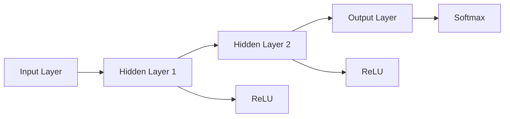

# Understanding the Mathematics of Neural Networks

This post explores the fundamental mathematical concepts behind neural networks, from basic linear algebra to advanced optimization techniques.

## Introduction

Neural networks have revolutionized machine learning [[1]], but at their core, they're built on elegant mathematical principles. In this article, we'll dive deep into the mathematics that make deep learning possible.

> "Mathematics is the language in which God has written the universe." — Galileo Galilei

---

## The Building Blocks

### Linear Transformations

At each layer, a neural network performs a linear transformation followed by a non-linear activation [[2]]. The basic operation is:

$$
\mathbf{z} = \mathbf{W}\mathbf{x} + \mathbf{b}
$$

Where:
- $\mathbf{W} \in \mathbb{R}^{n \times m}$ is the weight matrix
- $\mathbf{x} \in \mathbb{R}^{m}$ is the input vector
- $\mathbf{b} \in \mathbb{R}^{n}$ is the bias vector

### Activation Functions

Common activation functions include [[3]]:

1. **ReLU**: $f(x) = \max(0, x)$
2. **Sigmoid**: $\sigma(x) = \frac{1}{1 + e^{-x}}$
3. **Tanh**: $\tanh(x) = \frac{e^x - e^{-x}}{e^x + e^{-x}}$
4. **Softmax**: $\text{softmax}(x_i) = \frac{e^{x_i}}{\sum_j e^{x_j}}$

---

## Gradient Descent and Backpropagation

The learning process relies on minimizing a loss function $\mathcal{L}$ through gradient descent [[4]]:

$$
\theta_{t+1} = \theta_t - \eta \nabla_{\theta} \mathcal{L}(\theta_t)
$$

The gradient $\nabla \mathcal{L}$ is computed using the **chain rule** [[1]]:

$$
\frac{\partial \mathcal{L}}{\partial w_{ij}} = \frac{\partial \mathcal{L}}{\partial a_j} \cdot \frac{\partial a_j}{\partial z_j} \cdot \frac{\partial z_j}{\partial w_{ij}}
$$

### The Loss Landscape

For a typical neural network, we optimize over a complex, high-dimensional loss surface:

$$
\nabla \mathcal{L}^p = \left( \frac{\partial \mathcal{L}}{\partial \theta_1}, \frac{\partial \mathcal{L}}{\partial \theta_2}, \ldots, \frac{\partial \mathcal{L}}{\partial \theta_n} \right)
$$

---

## Code Example

Here's a simple implementation of a neural network layer in Python:

```python
import numpy as np

class DenseLayer:
    def __init__(self, input_dim, output_dim):
        self.W = np.random.randn(input_dim, output_dim) * 0.01
        self.b = np.zeros((1, output_dim))
    
    def forward(self, x):
        self.x = x
        self.z = np.dot(x, self.W) + self.b
        return self.z
    
    def backward(self, dz, learning_rate=0.01):
        m = self.x.shape[0]
        dW = np.dot(self.x.T, dz) / m
        db = np.sum(dz, axis=0, keepdims=True) / m
        dx = np.dot(dz, self.W.T)
        
        self.W -= learning_rate * dW
        self.b -= learning_rate * db
        return dx
```

---

## Network Architecture Visualization



---

## Comparison of Optimizers

Modern optimizers like Adam [[5]] have improved upon basic gradient descent:

| Optimizer | Learning Rate | Momentum | Adaptive | Best For |
|-----------|--------------|----------|----------|----------|
| SGD | Fixed | No | No | Simple problems |
| Momentum | Fixed | Yes | No | Deep networks |
| Adam | Adaptive | Yes | Yes | General purpose |
| AdaGrad | Adaptive | No | Yes | Sparse data |
| RMSprop | Adaptive | No | Yes | RNNs |

---

## Key Takeaways

Here are the main points to remember:

- Neural networks are **differentiable functions** composed of linear transformations and non-linearities [[2]]
- **Backpropagation** efficiently computes gradients using the chain rule [[1]]
- **Optimization** algorithms like Adam improve upon basic gradient descent [[5]]
- Understanding the math helps you:
  - Debug training issues
  - Design better architectures
  - Implement custom layers

### Further Reading

For more on this topic, check out:

- *Deep Learning* by Goodfellow, Bengio, and Courville [[1]]
- *Pattern Recognition and Machine Learning* by Bishop [[2]]
- [3Blue1Brown's Neural Network Series](https://www.3blue1brown.com/topics/neural-networks) [[6]]

---

## Conclusion

The mathematics of neural networks, while initially daunting, reveals elegant structures. From the simple dot product to the intricate dance of gradients flowing backward through layers, each component serves a purpose in the learning process.

Understanding these foundations not only makes you a better practitioner but also opens doors to research and innovation in the field.

*Thanks for reading! Feel free to reach out with questions or comments.*

---

## References

1. [Goodfellow, Ian, Yoshua Bengio, and Aaron Courville. "Deep Learning". MIT Press, 2016.](https://www.deeplearningbook.org/)
2. [Bishop, Christopher M. "Pattern Recognition and Machine Learning". Springer, 2006.](https://www.microsoft.com/en-us/research/uploads/prod/2006/01/Bishop-Pattern-Recognition-and-Machine-Learning-2006.pdf)
3. [Nair, Vinod, and Geoffrey E. Hinton. "Rectified Linear Units Improve Restricted Boltzmann Machines". ICML, 2010.](https://www.cs.toronto.edu/~fritz/absps/reluICML.pdf)
4. [Ruder, Sebastian. "An Overview of Gradient Descent Optimization Algorithms". arXiv, 2016.](https://arxiv.org/abs/1609.04747)
5. [Kingma, Diederik P., and Jimmy Ba. "Adam: A Method for Stochastic Optimization". ICLR, 2015.](https://arxiv.org/abs/1412.6980)
6. [Sanderson, Grant. "Neural Networks". 3Blue1Brown, 2017.](https://www.3blue1brown.com/topics/neural-networks)
