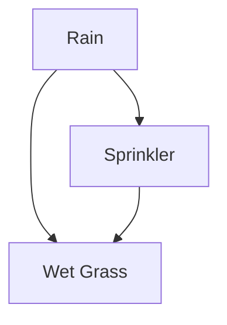

# Probabilistic Graphical Models

Introduction to Bayesian networks and Markov random fields.

## Overview

Probabilistic graphical models (PGMs) represent joint distributions over many variables using graph structures.

## Bayesian Networks

A Bayesian network is a directed acyclic graph (DAG) where:

$$
P(X_1, \ldots, X_n) = \prod_{i=1}^n P(X_i | \text{Pa}(X_i))
$$

### Example

$$
P(R, S, W) = P(R) \cdot P(S|R) \cdot P(W|R, S)
$$

## Markov Random Fields

Undirected graphical models with potential functions:

$$
P(X) = \frac{1}{Z} \prod_{C \in \mathcal{C}} \psi_C(X_C)
$$

where $Z = \sum_X \prod_C \psi_C(X_C)$ is the partition function.

## Inference

### Variable Elimination

Systematically sum out variables:

$$
P(X_q) = \sum_{X \setminus X_q} P(X_1, \ldots, X_n)
$$

### Belief Propagation

Message passing on trees:

$$
m_{i \to j}(x_j) = \sum_{x_i} \psi(x_i, x_j) \phi(x_i) \prod_{k \in N(i) \setminus j} m_{k \to i}(x_i)
$$

## Learning

| Type | Given | Learn |
|------|-------|-------|
| Parameter learning | Structure, Data | Parameters |
| Structure learning | Data | Structure, Parameters |

