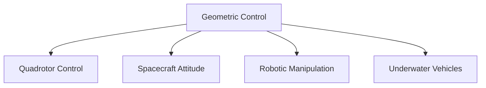

# Geometric Control on Lie Groups

Studying the mathematical foundations of geometric control theory and its applications to autonomous systems operating on non-Euclidean manifolds.

## Motivation

Many robotic systems naturally evolve on Lie groups rather than Euclidean space:

- Rotations: $SO(3)$
- Rigid body motion: $SE(3)$
- Quadrotor dynamics: $SE(3) \times \mathbb{R}^6$

## Lie Groups and Lie Algebras

A Lie group $G$ is a smooth manifold that is also a group. Its Lie algebra $\mathfrak{g}$ is the tangent space at identity.

### The Exponential Map

$$
\exp: \mathfrak{g} \to G
$$

For $SO(3)$, this is Rodrigues' formula:

$$
\exp([\omega]_\times \theta) = I + \sin\theta [\hat{\omega}]_\times + (1 - \cos\theta)[\hat{\omega}]_\times^2
$$

## Dynamics on Lie Groups

The kinematics of a system on $G$:

$$
\dot{g} = g \cdot \xi
$$

where $\xi \in \mathfrak{g}$ is the body velocity.

### Error Dynamics

For tracking control, define error:

$$
e = g_d^{-1} g
$$

The error dynamics become:

$$
\dot{e} = e \cdot \xi - \text{Ad}_{e^{-1}} \xi_d
$$

## Control Design

### Proportional-Derivative Control

On $SO(3)$, a geometric PD controller:

$$
\tau = -k_p e_R - k_d \omega
$$

where $e_R = \frac{1}{2}(R_d^T R - R^T R_d)^\vee$ is the rotation error.

```python
def geometric_pd_control(R, R_d, omega, omega_d, kp, kd):
    """Geometric PD controller on SO(3)"""
    # Rotation error
    e_R = 0.5 * vee(R_d.T @ R - R.T @ R_d)
    
    # Angular velocity error
    e_omega = omega - R.T @ R_d @ omega_d
    
    # Control torque
    tau = -kp * e_R - kd * e_omega
    return tau
```

## Stability Analysis

Using a Lyapunov function on the Lie group:

$$
V(e, \dot{e}) = \frac{1}{2}\|\log(e)\|^2 + \frac{1}{2}\|\dot{e}\|^2
$$

### Almost Global Stability

For attitude control, we achieve almost global asymptotic stability (excluding antipodal points).

## Applications



## Key Contributions

1. Intrinsic formulation avoiding singularities
2. Global (or almost global) stability guarantees
3. Natural extension to trajectory tracking
4. Coordinate-free implementation

