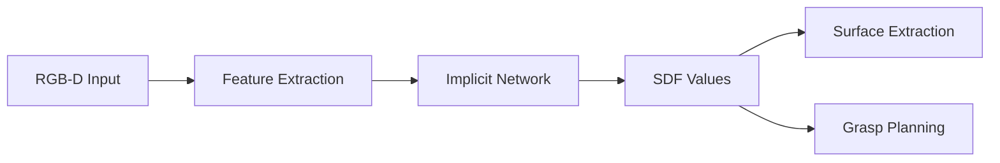

# Neural Implicit Representations for 3D Scene Understanding

Exploring coordinate-based neural networks for encoding spatial information, with applications to robot perception and manipulation tasks.

## Introduction

Neural implicit representations use neural networks to represent continuous 3D scenes. Instead of discrete voxels or meshes, we learn a function $f: \mathbb{R}^3 \to \mathbb{R}$ that maps coordinates to properties.

## Mathematical Foundation

### Signed Distance Functions

A signed distance function (SDF) maps each point to its signed distance from the surface:

$$
f(\mathbf{x}) = \begin{cases}
-d(\mathbf{x}, \partial\Omega) & \text{if } \mathbf{x} \in \Omega \\
d(\mathbf{x}, \partial\Omega) & \text{if } \mathbf{x} \notin \Omega
\end{cases}
$$

### Occupancy Networks

Binary classification of space:

$$
f_\theta: \mathbb{R}^3 \to [0, 1]
$$

where $f_\theta(\mathbf{x}) = 1$ indicates occupied space.

## Architecture

```python
import torch
import torch.nn as nn

class ImplicitNetwork(nn.Module):
    def __init__(self, input_dim=3, hidden_dim=256, num_layers=8):
        super().__init__()
        
        layers = [nn.Linear(input_dim, hidden_dim), nn.ReLU()]
        for _ in range(num_layers - 2):
            layers.extend([nn.Linear(hidden_dim, hidden_dim), nn.ReLU()])
        layers.append(nn.Linear(hidden_dim, 1))
        
        self.network = nn.Sequential(*layers)
    
    def forward(self, coords):
        return self.network(coords)
```

### Positional Encoding

To capture high-frequency details, we use Fourier features:

$$
\gamma(\mathbf{x}) = [\sin(2^0\pi\mathbf{x}), \cos(2^0\pi\mathbf{x}), \ldots, \sin(2^{L-1}\pi\mathbf{x}), \cos(2^{L-1}\pi\mathbf{x})]
$$

## Applications in Robotics

| Application | Method | Benefit |
|-------------|--------|---------|
| Grasp Planning | SDF queries | Continuous surface normals |
| Collision Detection | Occupancy network | Fast point queries |
| Object Reconstruction | NeRF/SDF | Complete 3D models |
| Scene Editing | Compositional SDFs | Modular manipulation |

## Results

Our implicit representation achieves:

- 5mm surface reconstruction accuracy
- 100Hz inference for collision queries
- Memory-efficient scene representation



## Conclusion

Neural implicit representations offer a powerful paradigm for 3D scene understanding in robotics, enabling continuous queries and gradient-based optimization for manipulation tasks.

